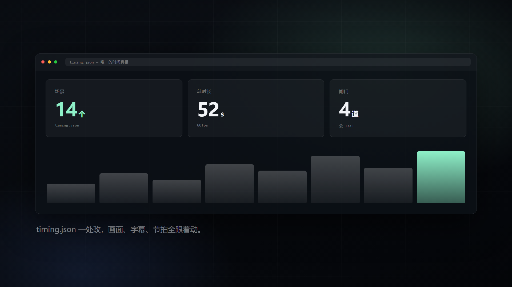
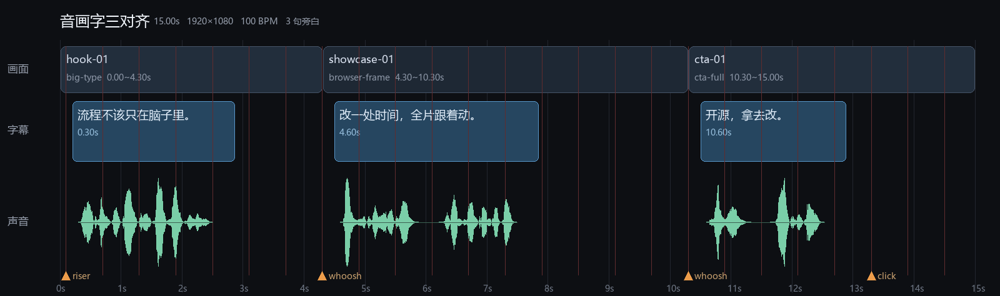
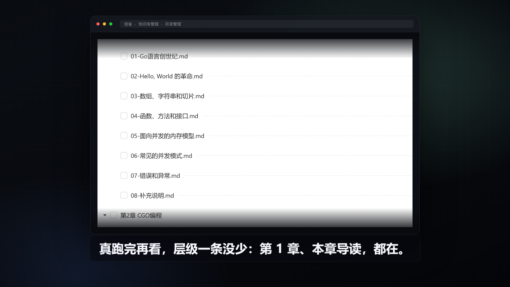

# promo-video-skill

把「做一支产品宣传片」拆成 AI 能照着执行的规范，配一套可跑的 Remotion 骨架和会 fail 的校验闸门。

- **谁在执行**：DeepSeek（本机 agent）为主，Cursor / Claude Code 也能跑
- **跑在哪**：Windows 优先（PowerShell），Linux / macOS 兼容
- **现在到哪了**：P6 完成——音画字三对齐（旁白、字幕、画面讲的是同一件事，且时间上对得上）由数据结构保证、由闸门兜底；十道闸门仍收在一条 `scripts-win\verify.cmd` 里。P1 的 demo、P2 的六个效果组件、P3 的三道新闸门都在，从样帧到成片的每一步都有脚本能判真假

## 为什么有这个项目

看了 [liyupi/ai-promo-video-maker](https://github.com/liyupi/ai-promo-video-maker)：它证明了「整条短片流程可以写成规范让 AI 执行」，但它是给 Cursor + 生图模型 + ElevenLabs 那套工具链写的——Windows 跑不通（脚本里全是 `python3`、`mkdir -p`、`bash -o pipefail`）、要生图、要配音、30KB 规范常驻上下文。

我想要的是同一套方法，在我自己的条件下能跑：没有生图、没有 ElevenLabs、Windows、上下文预算有限。

所以这个项目的定位是：**借它的结构，换它的手脚**。哪些借、怎么改、哪些不借，全部写在 [docs/借鉴清单.md](docs/借鉴清单.md)。

## 一句话原则

> 抄约束，不抄代码。规范里每一条都必须能用「截图 / 脚本输出 / 秒数」判定真假；不能判定的就不是规范，是许愿。

## 目录结构

```
AGENTS.md              常驻规范，7.3KB（对方是 30KB）
references/            按需加载的长文档，AI 只在对应阶段读
  需求问询.md           两轮提问清单 + 需求确认模板
  节奏.md               镜头时长底线 + 信息密度 + timing.json 结构
  校验清单.md           自动闸门 / 审图 / 交付前三层
  素材.md               截图规格、版权边界、降级顺序
scripts-win/           Windows 可跑的脚本（.cmd 包装 + .ps1 + .py）
  doctor.ps1/.cmd       环境体检：Node/npm/Python/Pillow/Chrome/git/中文字体/ffmpeg/磁盘
  shot.ps1/.cmd         HTML 截图，默认 1920×1080@2x = 3840×2160
  grab.ps1/.cmd         抓真实网页：整页截图 / 按选择器截元素 / 等某个元素出现
  mask.py               截图打码与裁剪：按区域裁掉敏感区、马赛克、检测超大纯色边
  new-project.ps1/.cmd  复制 template 建新项目 + 装依赖
  gen_music.py          按 timing.json 的 BPM 生成占位配乐（四段结构 + 落拍重音）
  gen_sfx.py            生成 whoosh / click / riser 等音效，落点来自 timing.json
  gen_vo.py             逐句合成旁白、掐静音、RMS 归一化、时长写回 voiceLines
  check_timing.py       分镜结构、时长底线、版式重复、layout 是否真注册过、时间轴连续性
  check_assets.py       素材宽度、比例、重名、中文文件名、疑似小图放大
  check_stills.py       静帧体检：相邻截图差值，抓「时间轴在走、画面不动」
  stills.ps1/.cmd       批量截帧：读 timing.json，每个场景 35% / 85% 处 + 首尾帧 → out/stills/（check_stills 的输入）
  check_video.py        成片体检：分辨率、时长、码率（不依赖 ffmpeg）
  check_audio.py        混音体检：人声 vs 音乐电平差、响度、短静音
  check_sync.py         音画字对齐：字幕窗、句子是否越场景、音效是否踩拍
  probe.ps1/.cmd/.js    排版探针：headless Chrome 量 DOM，查文字被裁 / 图片变形 / 出画 / 缺字体
  verify.ps1/.cmd       一键体检：目录/环境/时间轴/素材/配乐/同步/静帧/排版/成片/编码 十道闸门汇总成一张表，有 ERROR 就 exit 1
  fix-encoding.ps1/.cmd 编码规整：.ps1 补 BOM + CRLF、.cmd 转 CRLF、其余 LF（-Check 只查不改）
  sheet.py              把一目录静帧拼成对比图（审图用）
template/              可复制的 Remotion 工程
  timing.json           分镜与时间（唯一真相）
  src/Root.tsx          1080p / 4K 两套 Composition + layout 路由
  src/lib/timing.ts     秒↔帧换算、节拍相位
  src/lib/anim.ts       enter（四个入场角色）/ spring（阻尼振子 ζ=0.50）/ ramp / keys / impulse / shake / typed / beatAt，全部「帧 → 值」
  src/effects/          六个效果组件：网格渐变底 / 颗粒+暗角 / 光扫 / 动态大字 / 等距卡片 / 数字滚动
  src/components/       Backdrop（径向光 + 网格 + 暗角 + 随拍呼吸）
  src/scenes/           Hook / Showcase / Cta / EffectsLab（样板间）
examples/               只放自包含的纯文本样张，合计 10 KB（见本节末尾说明）
  card.html             1920×1080 样张，换配色只改 3 个 CSS 变量
  bad.html              故意做错的样张（拉伸图 / 裁字 / 出画 / 缺字体），用来验证探针真的会 fail
  timing.example.json   52 秒 / 60fps / 14 场景的示例分镜（含两段快切蒙太奇）
docs/                  给人看的：借鉴清单、踩坑记录、样帧
  pilot/                实拍记录：需求确认单、复盘（闸门在真实规模下的 8 个问题）
out/                   静帧、对比图、成片（不进 git）
```

> **`examples/` 为什么只剩三个文件**：P7 那支真片的完整工程 `examples/yuque-promo/`（27 个 tsx/ts + 7 张真实截图 2.2 MB + package-lock 161 KB）已移出仓库以控制体积，只保留闸门真正要用的纯文本样张——反例 `bad.html`、对照 `card.html`、示例分镜 `timing.example.json`，三个合计 10 KB，全部自包含、零图片依赖。
> 取回完整工程：`git checkout 600feb7 -- examples/yuque-promo`（`600feb7` 是它被移出前的最后一个提交）。只想看结构的话 `git show 600feb7:examples/yuque-promo/timing.json` 就够——那是一份 47.5s / 1425 帧的真片时间轴。
> 顺带一提：这个目录原先看着占空间，其实被 git 跟踪的只有 2.53 MB，真正撑大的是 `yuque-promo/node_modules` 和 `out/`——它们本来就在 `.gitignore` 里，删掉不省仓库体积，下次 `npm i` 还会长回来。

## P0 验收结果（本机实测）


| 命令 | 结果 |
|---|---|
| `scripts-win\doctor.cmd` | 8 OK / 1 WARN / 0 FAIL，exit 0（WARN = 本机没装 ffmpeg） |
| `python scripts-win\check_timing.py examples\timing.example.json` | 0 ERROR / 0 WARN，14 场景 52.0s @60fps |
| `scripts-win\shot.cmd examples\card.html out\frame-4k.png` | 3840×2160 PNG，2,793,234 字节，2.3 秒 |
| `scripts-win\shot.cmd examples\card.html out\frame-1080.png -Scale 1` | 1920×1080 PNG，1.4 秒 |
| `python scripts-win\sheet.py --dir out --cols 2` | 1848×564 对比图，103KB |
| `python scripts-win\check_assets.py out --min-width 1920` | 0 ERROR / 2 WARN（扫到的对比图本身不是 16:9，预期噪音） |

必要条件：Node 18+、Python 3.9+（Pillow）、Chrome 或 Edge。ffmpeg 只在混音、抽帧、换音轨时需要。

## P1 验收结果（本机实测）



一支 15 秒、3 场景（大字钩子 → 浏览器框数据展示 → 落点网址）的 demo，全部由 `timing.json` 驱动：

| 命令 | 结果 |
|---|---|
| `npm run typecheck` | exit 0 |
| `npm run render` | 450 帧 / 1920×1080 / 3.4MB / 28.6 秒 |
| `npm run render4k` | 450 帧 / 3840×2160 / 8.7MB / 79 秒 |
| `python scripts-win\check_video.py template\out\demo-1080p.mp4 --timing template\timing.json` | 15.00s / 1.80 Mbps / 1920×1080 / 0 ERROR |
| `python scripts-win\check_video.py template\out\demo-4k.mp4 --timing template\timing.json` | 15.00s / 4.66 Mbps / 3840×2160 / 0 ERROR（自动识别 2× 超采样） |
| `python scripts-win\check_timing.py template\timing.json` | 0 ERROR / 1 WARN（WARN = 15 秒不在 45~60 秒默认区间，demo 正常） |
| `scripts-win\new-project.cmd demo-video -Dest <空目录>` → `npm install` → `npm run render` | 端到端验过：全新目录建项目、装依赖、出片，`check_video.py` 0 ERROR |

两条实现取舍：

- **4K 用 CSS `zoom`**（`Root.tsx` 里 `zoom = width / WIDTH`），不是把 1080p 放大。裁 4K 静帧看地址栏小字，是按 4K 重新排版渲染的清晰文字；代价是 1px 边框会变 2px。
- **Remotion 自带编码器**，本机没装 ffmpeg 也能出 mp4；`check_video.py` 也不依赖 ffprobe，直接读 MP4 box。

## P2 验收结果（本机实测）


`template/src/effects/` 里六个组件，`npm run render:effects` 出一段 18 秒样板间，每段 3 秒演一个效果（第 5 段是「左半边有颗粒、右半边没有」的对照）：

| 组件 | 做什么 | 配上什么语义才不空转 |
|---|---|---|
| `GradientMesh` | 会呼吸的多点渐变底 | 所有片段的底，替代纯黑 |
| `FilmLook` | 颗粒 + 暗角 | 压住"AI 味"，让画面像拍出来的 |
| `LightSweep` | 一条斜向亮带扫过 | 品牌登场、场景切换、按钮被点亮 |
| `BigType` | 动态大字（`slam` 砸出 / `mask` 擦出） | 痛点、结论、口号 |
| `IsometricCards` | 等距视差卡片阵列 | 功能矩阵、模块全景、定价档位 |
| `CountUp` | 数字滚动到位 | 数据卖点（用户数、准确率、耗时） |

| 命令 | 结果 |
|---|---|
| `npm run typecheck` | exit 0 |
| `npm run render:effects` | 540 帧 / 1920×1080 / 5.5MB / 39.4 秒 |
| `python scripts-win\check_video.py template\out\effects.mp4 --duration 18` | 18.00s / 2.55 Mbps / 1920×1080 / 0 ERROR |

三条实现取舍：

- **颗粒不每帧重算**：一张 200×200 的 SVG `feTurbulence` 噪点板，三块轮换（`Math.floor(frame / 2) % 3`）+ 子像素抖动，`mixBlendMode: overlay`。每帧换 seed 要重新栅格化整块区域，4K 下渲染时间翻几倍；实测带颗粒的 540 帧 39.4 秒，摊到每帧只比 P1 不带颗粒的 demo 贵 14%。
- **效果组件不自己读 `useCurrentFrame`**，`frame` 由场景传进来。这样既能嵌进 `Sequence`，也能在样板间里并排比较、单独抽任意一帧渲染——这是「必须能 seek」那条硬规矩的具体做法。
- **三处是审图改出来的**（先看截图才发现，靠想象发现不了）：光扫 `strength` 1.25→0.62、带宽 620→480（1.25 时白成一整面墙，不像"扫过"）；等距卡片 `cardWidth` 300→330 加整体 `translate(4%, 6%)`（原来视觉重心偏左上、右下空一大块）；颗粒对照段用 `clipPath: inset(0 50% 0 0)` 只叠左半边，坐标仍按整帧算，不缩放折半——否则两半内容会错位。

## P3 验收结果（本机实测）

这一阶段补的是「靠肉眼看不出来的错」。原来的闸门只看文件：宽高对不对、时长对不对、码率够不够——于是「截图被拉扁了 4%」「标题第二个字被容器切掉了半截」「这一段三秒钟画面没动」全部能过。

**排版探针 `probe.cmd`**：不用 Playwright，headless Chrome 加 `--dump-dom` 就够——注入一段脚本量完盒子，把结果 base64 塞进一个 `<div>` 的属性里，dump 出来再解码。四类判定，每一条都是真人眼容易漏的：

| 检查 | 判定方式 | 级别 |
|---|---|---|
| 文字被裁 | 有文字的元素 `overflow` 非 `visible` 时，`scrollWidth/scrollHeight` 比客户区大出多少像素 | ERROR |
| 图片变形 | ``/`<video>` 的原始长宽比 vs 渲染长宽比，偏差 > 2% | ERROR |
| 出画 | 带文字的元素超出画布多少像素（纯装饰的渐变光斑出血不算） | WARN（`-Strict` 升 ERROR） |
| 缺字体 | 把字画进 canvas 比像素，和「不存在的字体」渲染结果一致就是没有 | WARN |

| 命令 | 结果 |
|---|---|
| `scripts-win\probe.cmd examples\card.html` | 0 ERROR / 3 WARN，1.3 秒（WARN = 字体栈里的 PingFang SC / Noto Sans SC / Cascadia Mono 本机没有） |
| `scripts-win\probe.cmd examples\bad.html` | **2 ERROR / 3 WARN，exit 1**：`img` 渲染 404×404 而原图 400×100（差 75%）、`.clipped` 纵向超出 132px、`.bleed` 出画 90px、两个缺字体 |

**静帧体检 `check_stills.py`**：`check_video.py` 能证明「片子是 18 秒」，证明不了「这 18 秒里有几百个不同画面」。

| 命令 | 结果 |
|---|---|
| `python scripts-win\check_stills.py`（3 张真实静帧） | 11.71 / 6.82，0 ERROR / 0 WARN |
| 同上，多塞一张重复帧 | 差值 0.00 → **1 ERROR，exit 1**：「两张截图完全一样：f246 → f297，动画没生效」 |

**素材放大检测 `check_assets.py`**：判的是细节而不是尺寸。把图缩到一半再放大回来，原生图会掉细节、放大图几乎无损；像素复制式放大还有成对的重复行列。用合成的标定样本量出来的阈值：

| 样本 | 缩半往返误差 | 重复行列 | 判定 |
|---|---|---|---|
| 原生 1920×1080 静帧 | 0.93 | 0% | 过 |
| 双三次 2× 放大 | 0.12 | 74% | 报 |
| 双三次 3× 放大 | 0.13 | 74% | 报 |
| NEAREST 2× 放大 | 0.49 | 87% | 报 |

阈值取「误差 < 0.30 或 重复行列 > 65%」，并要求图本身有内容（标准差 > 10，否则纯渐变背景会误伤）。六个样本（3 张合成放大 + 2 张原生静帧 + 1 张 JPEG 拼图）跑下来三张放大全部报出、三张原生全部没误报。

三条实现取舍：

- **不引 Playwright**：只为了量盒子装一个几十 MB 的浏览器驱动不值，Chrome 本来就在（`shot.ps1` 已在用），`--dump-dom` + base64 通道足够把结构化结果带回来。
- **字体靠像素比对，不靠宽度**：中文全角，任何字体下 5 个字的宽度都一样，`PingFang SC`、`Noto Sans SC` 和随便编的假名字量出来完全相同（实测都是 480px）。`document.fonts.check()` 更假——本机对所有族名都返回 `true`。
- **探针只对 HTML 有效**：Remotion 场景是 TSX，量不到 DOM。所以它的位置是「样帧 / 素材页 / 浏览器框里的页面」进 Remotion 之前那道闸；Remotion 自己的画面靠 `check_stills.py` 抓静止帧。

## P4 验收结果（本机实测）

六道闸门各自都能 fail，但它们散在六个脚本里，全靠人记得挨个跑。`verify.cmd` 把它们串成一条命令，输出一张表：哪一步 OK / WARN / FAIL / SKIP、耗时多少、以及失败项原来的那句话。

```powershell
scripts-win\verify.cmd my-video             # 体检一个项目
scripts-win\verify.cmd template -Self       # 体检本仓库自己（会跑 examples\*.html）
scripts-win\verify.cmd ..\proj -Video ..\proj\out\final-4k.mp4 -Strict -Quiet
```

十步：目录结构 → 环境（doctor）→ 时间轴（check_timing）→ 素材（check_assets）→ 配乐（check_audio）→ 同步（check_sync）→ 静帧（check_stills）→ 排版（probe，逐个 HTML）→ 成片（check_video）→ 编码（fix-encoding，只在 -Self 时跑）。

两件本来就该做对、之前没做的事：`-Html` 可以写相对路径了（相对当前目录或体检目录都认，脚本自己转成绝对路径；找不到会当场报「找不到 HTML」并列出试过的几个路径，不用等到第 8 步才露馅）；体检目录不是片子工程（缺 `timing.json` 或 `src\scenes`）时只打一行提示就 `exit 1`，不再把九道闸门挨个跑一遍刷屏——以前那种情况下真问题（目录指错了）会被几十行连锁报错埋掉。

两个兜底：`-Html` 可以写相对路径（先按当前目录、再按体检目录找，找到就转绝对；找不到当场报「找不到 HTML」并列试过哪些路径，不用等到第 8 步才发现）；体检目录压根不是片子工程（缺 `timing.json` / `src\scenes`）时只打一行提示就 `exit 1`，不再把后面九道闸门挨个跑一遍刷屏。

| 命令 | 结果 |
|---|---|
| `scripts-win\verify.cmd template` | 3 通过 / 2 警告 / 0 失败 / 2 跳过，3.0s，exit 0（警告 = 本机没装 ffmpeg、15 秒不在 45~60 秒区间） |
| `scripts-win\verify.cmd -Self` | 5 通过 / 2 警告 / 0 失败 / 1 跳过，5.0s，exit 0 |
| 故意做坏的项目（静帧重复 + 小图放大 + bad.html + 15 秒） | 2 通过 / 3 警告 / 2 失败，4.1s，**exit 1** |

坏项目里它逐条点名（原样输出）：

```
[ 4] 素材         WARN    0.5s  1 条警告
      - 疑似小图放大：shot-fake.png —— 缩半再放大误差 0.03，重复行列 88%，4K 下会糊，换大图或改用矢量/截图
[ 5] 静帧         FAIL    0.5s  1 个错误
      - 两张截图完全一样（差 0.00）：f060.png → f140.png —— 动画没生效，或在播同一帧
[ 6] 排版         FAIL    1.3s  1 张：bad.html
      错误 bad.html：图片变形：div.stage > img.stretched  渲染 404x404，原图 400x100（差 75%）
      警告 bad.html：字体全缺：字体栈「"PingFang SC", "Noto Sans SC", sans-serif」里的 PingFang SC、Noto Sans SC 本机都没有，浏览器用的是默认字体

结果：2 通过 / 3 警告 / 2 失败 / 0 跳过（4.1 秒）

失败项：
  - 静帧：1 个错误
  - 排版：1 张：bad.html
```

四条实现取舍：

- **判定规则留在各闸门里，verify 只调度和判词**：一旦把阈值抄进 verify，两边就会悄悄漂移。verify 拿到的是子脚本的 exit code 和输出原文。
- **WARN 不拦交付，FAIL 才 exit 1**：`-Strict` 把「看情况算不算错」的项（出画、时长）升级成失败。
- **成片的挑选顺序**：`final-4k` → `final-1080p` → `final` → `demo-4k` → `demo-1080p` → `demo` → `out/` 里最新的 mp4。少了这个顺序，`template/out/effects.mp4` 那条 18 秒样板间会被当成立片，报「时长 18.00s，期望 15.00s」。
- **`-Self` 会把根切到 `template/`**：在仓库根跑，第一步就会报「缺 timing.json」，把真问题淹掉；同时也排除 `examples\bad*.html` 这类故意做坏的反例，保证自检本身是绿的。

**字体判定的修正**（P3 的一个教训）：原来按「每个族名」判，`"Microsoft YaHei","PingFang SC","Noto Sans SC",sans-serif` 这种跨平台字体栈掉了一两个族名就告警——可这本来就是正确写法。现在按**整条栈**判：栈里一个族名都命中不了才报（那时浏览器用的是默认字体，字形完全不是你设计的那套）。改完 `examples\card.html` 从 3 WARN 变 0 WARN，`bad.html` 的「字体全缺」仍然抓得住。
## P5 验收结果（本机实测）

| 命令 | 实测 |
|---|---|
| `python scripts-win\gen_music.py template\timing.json --out template\public\bgm.wav` | 1292 KB / 15.00s / 峰值 -3.1 dBFS / RMS -19.0 dBFS |
| `python scripts-win\gen_sfx.py` | whoosh 0.55s、click 0.09s、riser 1.2s |
| `python scripts-win\check_audio.py template\public\bgm.wav --timing template\timing.json` | 实测 100.0 BPM / 相位 0.13s（偏差 +0.0 BPM、-20 ms）/ 0 ERROR |
| `scripts-win\say.cmd "把流程写成规范，不是提示词，是施工图。" -Out tmp\voice.wav -Rate -2` | 6.85s / 295 KB / Microsoft Huihui Desktop（zh-CN） |
| `python scripts-win\check_audio.py tmp\voice.wav --narration` | 0 ERROR（旁白模式：句间自然停顿不算毛病） |
| `npm run render` | 3.80 MB，音轨 `mp4a 2ch 48kHz` |
| `scripts-win\verify.cmd -Self` | 7 通过 / 2 警告 / 0 失败 / 0 跳过（11.7 秒） |


上图是 `check_audio.py --png` 顺手画出来的：上半是波形，下半是频谱，红线按 `timing.json` 的 BPM / offset 画——红线刚好压在每次起音上，就说明音乐踩对了拍。这张图比听十遍都直观：第一版的小节线错开 0.15 秒时，红线正是歪在起音缝里的。

为什么自己合成音乐而不是找素材：**版权**（宣传片是要商用的）和**可复现**（同一份 timing.json 每次生成的 wav 逐字节相同，改完 BPM 重跑一次就好）。`gen_music.py` 读 `timing.json` 的 `beats.bpm/offset` 和 `duration`，A 小调六小节 Am Am F F C G，pad + 贝斯 + 底鼓 + 镲 + 十六分拨弦，单声道 44.1kHz。这是「能用」的占位，不是成品配乐——真做商业片把这一轨换成买来的音乐，其余一个字不用改。

三条实现取舍：

- **小节线必须落在拍网格上**：第一版写 `t0 = i * bar`（0、2.4、4.8…），而拍网格从 `offset=0.15` 起算，整条音乐的小节和拍点错开 0.15 秒——听感上是「一直差半口气」，看波形看不出来，是 `check_audio.py` 报「相位差 -150 ms」才暴露的。
- **拍点检测只看底鼓频段**：宽带起音曲线会被开头淡入骗到（那一下比任何一拍都猛），实测把相位拽到 0.00s。改成 FFT 带通 40~120 Hz + 跳过前 0.2 秒，同一份音频立刻测出 0.13s（真值 0.15s）。判据也不是「绝对相等」：BPM 差 >2 或相位差 >60 ms 才 ERROR。
- **有没有声音分两层查**：`check_audio.py` 查音频文件本身（时长、电平、拍点位置），`check_video.py` 查成片里有没有 `soun` 轨。Remotion 的 `<Audio>` 路径写错会**静默跳过**——片子照常渲染，只是没声；现在 timing.json 配了 `audio.bgm` 而成片无音轨，直接 ERROR。

音轨在 `template/src/Soundtrack.tsx`：背景音乐用帧回调算音量包络（淡入 0.2s / 淡出 0.9s），音效按 `audio.sfx[].at` 插在场景切点，全部读 `timing.json`。旁白是可选的一条轨（`audio.voice`），先用 `say.cmd` 合成再丢进 `public/`。
## P6 验收结果（本机实测）

这一阶段解决的是全片最致命的一种废：**声音、字幕、画面各说各的**。话没说完画面切走了、屏幕上两行字幕打架、配乐在第三秒切但那句台词念到第五秒——这些错一个，片子就废，而 P0~P5 的七道闸门一条都查不到。它们查的是文件属性（宽高、时长、码率、有没有音轨），而错位是**三份数据之间的缝**。

| 命令 | 实测 |
|---|---|
| `python scripts-win\gen_vo.py` | 3 句 / 7.03s，掐掉 SAPI 尾部空白 2.80s（3.16→2.21、3.84→2.89、2.82→1.93） |
| `python scripts-win\check_sync.py -Project template --png docs\img\sync.png` | 0 ERROR / 0 WARN |
| 反例 A：改字幕文本不重合成 | 1 ERROR `字幕文本改过，但音频还是旧的（指纹对不上）`，exit 1 |
| 反例 B：一句话拖到下一个场景 | 3 ERROR `说到 5.10s，场景 hook-01 在 4.30s 就切走了`，exit 1 |
| 反例 C：两句字幕撞在一起 | 2 ERROR `字幕撞车：hook-01-1 显示到 2.86s，showcase-01-1 从 2.30s 就开始显示`，exit 1 |
| 反例 D：删掉结尾音效 | 1 ERROR `结尾 CTA 落地 0.4 秒内没有任何音效`，exit 1 |
| `npm run render` | 3.78 MB，音轨 `mp4a 2ch 48kHz`，15.00s |
| `scripts-win\verify.cmd -Self` | 8 通过 / 2 警告 / 0 失败 / 0 跳过（5.7 秒） |



这张图由 `check_sync.py --png` 画出来，三条泳道共用一根时间轴。判断错位不需要听：**字幕条没盖住波形**就是说话时没字；**字幕条伸进了右边那格**就是话没说完画面就换了；**橙色三角没压在红线上**就是音效没踩拍。上面这张里，三个字幕条都严丝合缝地裹住自己那段波形，四个音效全落在红色拍点线上。

### 为什么让对齐「在结构上成立」，而不是事后检测

最容易想到的做法是：录一条完整旁白，再用语音识别倒推每句在哪一秒，然后对字幕。这条路一定翻车——识别错一个词、断句差一句，后面全体顺移，而且**错了没人知道**，因为没有任何一份数据能证明它错。

所以反过来做：**每句旁白一个文件**。`gen_vo.py` 逐句合成 `public/vo/<场景>-<序号>.wav`，然后把「这句话在第几秒开始、持续多久、文本是什么」写回 `timing.json` 的 `voiceLines`：

- `at` 是**我们指定**的（场景起点 + 0.3 秒），不是猜的；
- `dur` 是从 wav **量出来**的，不是估计的；
- `sha1` 是文本指纹，用来抓「改了字幕忘了重新合成」。

于是字幕组件（`template/src/Subtitles.tsx`）只需要读 `voiceLines`，声音组件（`Soundtrack.tsx`）读同一份，画面读 `scenes`。**三者本来就是一伙的，错位只能来自「改了其中一份没改另一份」**，而这恰好是脚本能查的：

| 错位怎么发生 | 闸门怎么发现 |
|---|---|
| 改了字幕文案没重合成 | `sha1` 对不上 |
| 换了音频没更新 `dur` | 文件实测时长与声明差 >20ms |
| 句子太长，念到了下一个场景 | `at + dur > 场景 end` |
| 两句挨太近，同屏两行字 | 显示窗（含 0.1s 进 / 0.35s 出）互相重叠 |
| 说话时画面在演别的 | 句子所属场景与 `at` 所在场景不一致 |
| 字幕和画面大字一字不差 | 文本归一后相等 → WARN（观众会以为在重复念） |
| 念得太快听不清 | 语速 <2 或 >7 字/秒 |

### 三个坑（都是这次实测踩出来的）

- **SAPI 每句尾部留将近 1 秒空白**。第一版直接把 wav 时长当台词时长：字幕条比这句话长出三分之一，下一句起点被推后，「节奏」整个拖沓下来。`gen_vo.py` 现在合成后立刻掐首尾静音（阈值 0.004 ≈ -48 dBFS，两头各留 50ms），三句共去掉 2.80 秒。
- **拍点不一定落在整帧上**。100 BPM @30fps 一拍正好 18 帧，但只要 `beats.offset` 是半帧（0.15s = 4.5 帧），所有拍点都落在半帧上——于是任何「踩拍」的场景切点都必然不在整帧上，`check_timing.py` 立刻报 `end=4.35s 不落在整帧上（130.5 帧）`。解法是把 offset 挪到整帧：`0.1s` = 第 3 帧，切点落在 frame 129 / 309。`check_audio.py` 现在会主动提示这件事。
- **画面大字和字幕说了同一句话**。demo 第一版开场大字是「把流程写成规范」，旁白也是「把流程写成规范。」——看着像音轨串了。改成旁白说「流程不该只在脑子里。」（提出问题），大字给「把流程写成规范」（给出答案），才对得上「声音负责叙事、大字负责命中」。

音效闪避也在这层：`audio.duck` 默认 8 dB，旁白说话的窗口内背景音乐按帧压到 −8 dB（上下各 0.25s 斜坡），所以「人声比音乐高 8 dB」这条不是靠手调音量撞出来的，是算出来的。
## P7 实战：给一个真项目拍一支整片

前六个阶段的对象都是 `template/` 里那个 15 秒的假产品。**闸门在 demo 上全绿，不代表它在真片上成立**——这一阶段把 `code/yuque-import-skill`（GitHub 仓库搬进语雀）真拍了一条，成片工程原在 `examples/yuque-promo/`（已移出仓库，取回方式见「仓库结构」一节）。

| 项 | 值 |
|---|---|
| 时长 / 帧数 | 47.5s / 1425 帧 @30fps（demo 的 3.2 倍，第一次跑真实长度） |
| 结构 | 6 场景：大字开场 / 数字痛点 / 终端 dry-run / 语雀目录树 / 知识库列表 / CTA |
| 真实截图 | 4 张，全部来自真实页面与真实脚本输出（终端里 1210 节点那行是 `--dry` 的原样 stdout） |
| 旁白 / 配乐 | 10 句 edge-tts（zh-CN-XiaoxiaoNeural，神经语音，共 33.9s，占全片 71%）+ 程序生成的 BGM（100 BPM，六个切点全踩在拍上） |
| 出片 | 1080p 14.4 MB；4K 33.2 MB（2× 超采样） |
| `verify.cmd` | 5 通过 / 3 警告 / 0 失败 / 1 跳过 |



真片一上来就把闸门打出七个 ERROR，逐个修完的完整记录在 [docs/pilot/复盘.md](docs/pilot/复盘.md)，四条值得写进规范的：

- **`kind` 是枚举，不是自由文本**。`cta / hook / info / montage / showcase / transition` 六选一，自创名字直接被拦；改时长后 `beats` 必须重算，否则报「beats 落在场景之外」。
- **字幕条会压住截图卡片**。`Subtitles.tsx` 占掉底部约 90px，任何卡片底边超过 y≈880 就被盖住。`Shot` 组件因此有了 `offsetY`，卡片高度也按「避开字幕带」反推。
- **声画对齐的最后一厘米是电平**。本机 SAPI 旁白 RMS 只有 -26 dBFS，混完人声只比音乐高 5.3 dB（规范要 ≥8）。`gen_vo.py` 现在逐句归一化到 -18 dBFS、tanh 软限幅（`--rms` 可调），并把 BGM 压到 0.32，实测人声比纯音乐段高 9.3 dB。
- **旁白不是「凑够时长」就行，中间的空档也会劝退人**。第一版 49.9 秒里旁白只有 22.7 秒（45%），`term-03` 一场 10.8 秒只说了 4 秒，剩下 6.5 秒观众盯着一个滚动的终端等下一句。改法三条一起上：每场拆成两句话（10 句、33.9 秒、占比 71%）、场景长度按「话说完就走」收短、句间 `--gap 0.95`（字幕的 `SUB_PAD_OUT 0.35 + SUB_PAD_IN 0.1` 会吃掉 0.45 秒，gap 给小了 `check_sync` 会报「念得太赶」）。现在最长空档 2.1 秒，落在片尾 CTA 上。
- **SAPI 那副嗓子不能交付**。它是 2000 年代的拼接式合成，念出来的中文像机器报站。`gen_vo.py` 加了 `--engine edge`：走 edge-tts 的微软神经语音（`zh-CN-XiaoxiaoNeural` 等 8 个中文音色），同样逐句合成、掐静音、归一化，句子从 30.97s 缩到 22.71s，语速自然 5 字/秒；`--engine sapi` 保留作断网兜底。
- **裁截图要用 2× 原图裁，且按行边界裁**。从小图再裁会被 `check_assets` 判「4K 下会糊」；按比例硬切会把卡片切成半截。

素材合规在这次也定成了硬规矩：**只用公开知识库截图，打码靠裁不靠涂**——私有库（付费课程、个人笔记）一张都不进片，顶栏用户名、左栏知识库列表整片裁掉，涂抹漏一次就是把别人账号播出去。

## 怎么用

```powershell
# 0. 先体检（Node / Python / Chrome / 字体 / ffmpeg / 磁盘 一次看清）
scripts-win\doctor.cmd

# 1. 复制骨架建项目：拷 template、改包名、装依赖
scripts-win\new-project.cmd my-video -Dest ..

# 2. 改 timing.json 定节奏与文案（scenes[].onscreen），src/scenes/ 只管怎么摆

# 3. 配乐（可选）：从 timing.json 的 BPM 生成一条占位 BGM，再用生成器补齐音效
python ..\scripts-win\gen_music.py timing.json --out public\bgm.wav
python ..\scripts-win\gen_sfx.py --out-dir public\sfx

# 4. 旁白与字幕（可选）：在 timing.json 的 scenes[].voice 里写台词（多句用 | 隔开），
#    逐句合成并写回 voiceLines——字幕组件紧接着读这份，声音和字从此不会错开
python ..\scripts-win\gen_vo.py -Project .
python ..\scripts-win\check_sync.py -Project .      # 说话时有没有字、字会不会撞、念到哪切了没

# 5. 审图：按时间轴截帧（每场景 35% / 85% + 首尾帧）→ 查相邻帧有没有在动
npm run stills          # → out\stills\f0000.png …；只截中点加 -- -Mid，长片加 -- -Step 0.5
npm run check:stills    # 相邻帧差值，< 0.05 说明渲了同一帧，< 0.6 说明那段没动
npm run sheet           # 拼成 out\sheet.jpg，一张图看完全片

# 6. 出片
npm run render       # 1080p，约 30 秒
npm run render4k     # 4K，约 80 秒

# 7. 交付前体检：一条命令跑完十道闸门，有 ERROR 就 exit 1
scripts-win\verify.cmd .
```

npm 被 PowerShell 执行策略拦住时（见 [docs/windows-踩坑记录.md](docs/windows-踩坑记录.md) 第 1 条），用 `npm.cmd run render`。

### 文案写在哪

画面的字**全部**来自 `timing.json` 的 `scenes[].onscreen`，TSX 里不写字——它只负责把这些字摆好看。槽位名、`@token`、`layout` 名都由 `check_timing.py` 验，写错当场报错，不用等到渲染完才发现。

`layout` 必须真在 `src/Root.tsx` 的 `LAYOUTS` 里注册过（脚本直接读那份注册表，不维护第二份手抄清单）。写错一个字母——`big-type` 写成 `big_type`——以前十道闸门全绿，渲染出来是一块红底 `Missing` 屏，只能靠肉眼看片才发现；现在直接 ERROR 并列出可用值。顺带两条：注册了却没有场景用到的 layout 报 WARN（多半是改名后的残留）；`onscreen` 填了某个槽位、但该 layout 的组件里根本没引用这个槽位也报 WARN（那段字永远不会出现在画面上）。工程根不是 `timing.json` 所在目录时用 `--root` 指；样例分镜放在仓库外、没有 `src/Root.tsx` 时这一项打印 `[跳过]`，不误报。

```json
"onscreen": {
  "kicker": "promo-video-skill",
  "lines": ["把流程写成", "**能执行**的规范。"],
  "sub": "不是提示词，是带秒数、带配额、带闸门的施工图。"
}
```

- **槽位**：`kicker` / `lines` / `sub` / `overline` / `title` / `url` / `caption` / `tail` / `stats`。哪个版式读哪几个由场景组件决定；新加版式顺手在 `src/lib/timing.ts` 的 `OnscreenMap` 里补上。
- **强调色**：`**字**` 之间的部分用强调色（`src/lib/rich.tsx`）。一屏只标一处。
- **派生数字**：`stats[].value` 可以写 `@scenes` / `@duration` / `@frames` / `@fps` / `@gates`，渲染时算成真值；`hint` 里也能用（`"@fps fps"` → `30 fps`）。手写的数字迟早和 `timing.json` 漂开，所以干脆不让手写。
- **缺文案**：槽位空着会在画面上印 `〔缺文案：lines[1]〕`——宁可难看，也别静默留白。
- **旧格式**：`"onscreen": ["一段摘要"]` 这种字符串数组已经不被渲染器接受，改成 `{"lines": [...]}` 就行（摘要格式没人读，改了也不会有任何视觉变化——这正是要废掉它的原因）。

## 路线图

| 阶段 | 内容 | 完成标志 |
|---|---|---|
| P0 | 骨架：精简 AGENTS.md + 4 份 references + Windows 脚本 | ✅ 空项目能出一张 1920×1080 静帧 |
| P1 | Remotion 骨架 + 15 秒 demo（3 场景） | ✅ `npm run render` 出片，1080p / 4K 都过 `check_video.py` |
| P2 | effect kit：网格渐变底 / 颗粒+暗角 / 光扫 / 动态大字 / 等距卡片 / 数字滚动 | ✅ 6 个组件 + 18 秒样板间，`npm run render:effects` 出片过 `check_video.py` |
| P3 | 校验闸门：assets / stills / probe / video | ✅ 坏资产、压扁截图、缺字体、静止帧都能自动报错（examples\bad.html 是反例样本，跑它必 exit 1） |
| P4 | 一条命令串起六道闸门（verify） | ✅ 正常项目 exit 0、坏项目 exit 1 并点名原因（静帧重复 / 小图放大 / 排版两个 ERROR） |
| P5 | 声音：合成配乐 / 音效 / 离线旁白 + 拍点与音轨校验 | ✅ 配乐实测 100.0 BPM、相位偏差 -20 ms；成片带 mp4a 音轨；旁白可离线合成并单独体检 |
| P6 | 音画字三对齐：逐句旁白 + 字幕同源 + `check_sync.py` | ✅ 四个坏样本全部 exit 1 并点名原因；三轨时间轴图一眼看出错位；顺带修掉 SAPI 尾部静音与半帧拍点 |
| P7 | 实拍验证：把整条流程用在真项目上，拍一支整片 | ✅ `examples/yuque-promo`（已移出仓库）出 1080p/4K 成片（47.5s），`verify` 0 失败；闸门在真实规模下暴露的 8 个问题已回写脚本与规范 |

## 授权与致谢

- 本仓库自有代码 MIT。
- 借鉴自 ai-promo-video-maker（MIT）。抄了结构或代码片段的地方在 `docs/借鉴清单.md` 里标了出处；照抄代码需保留原版权声明。
- 不复制对方 `references/` 的原文，只吸收结构与判定标准，文字全部重写。对方的案例复盘和踩坑记录属于它的实战资产，抄不走。
- Remotion 只对 3 人以内公司免费；ElevenLabs 免费套餐产物不可商用。本项目的默认路线不依赖这两者的付费能力。
