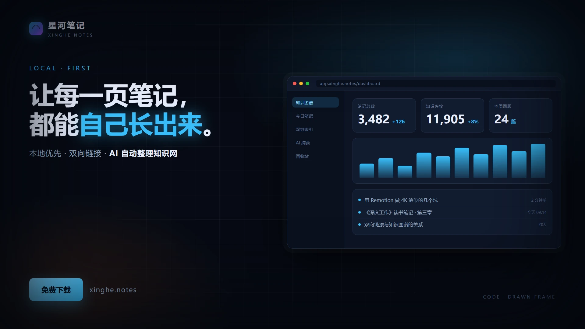
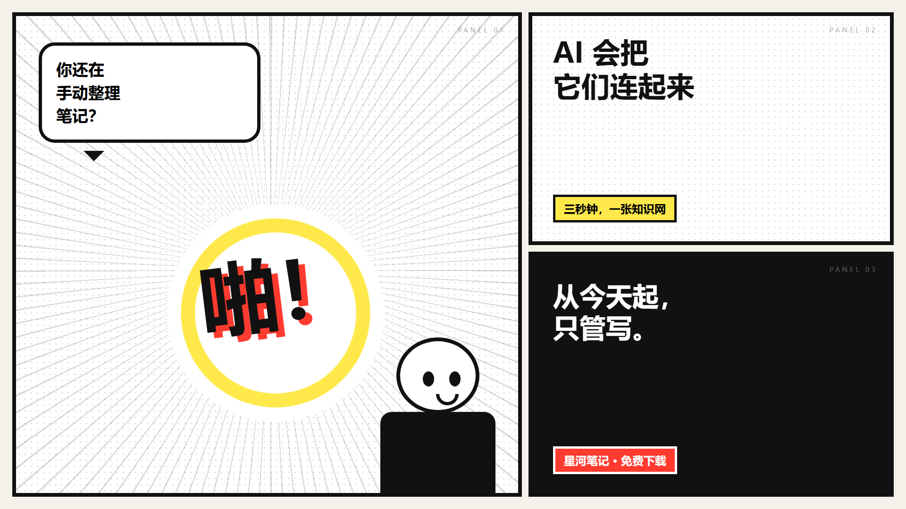

# 借鉴清单

对标仓库：[liyupi/ai-promo-video-maker](https://github.com/liyupi/ai-promo-video-maker)（MIT，2026-10-09 首次开源，单 commit，471 stars）。
本文只回答一件事：**哪一部分值得抄，哪一部分抄了会亏。**

---

## 结论先放这

按「不可替代性」排序，对方真正值钱的东西是这五样：

1. **节奏表**——十几条秒数阈值。纯知识，抄的成本为零，收益最大。
2. **校验清单**——每条都形如「≥1.3 秒」「≥8 张」「≥8 dB」，能自动判真假。整套方法能自我纠错全靠它。
3. **需求确认.md**——把口头共识变成文件，之后所有返工以它为准。
4. **分层加载**——常驻规范 + 按需长文档，这是上下文预算的工程做法。
5. **会 fail 的脚本**——把「我觉得没问题」换成「机器说没问题」。

抄不走的：约 88KB 的 `references/`（8 份）里，压着 5 支成片的返工记录——`踩坑记录.md` 19687 字节、`案例复盘.md` 7820 字节。那是「第几版被评了什么、为什么改」的具体痕迹，复制文本也复制不了经验。

所以判断是：**结构可以一天抄完，内容得自己攒半年。**

| 模块 | 判定 | 说明 |
|---|---|---|
| 节奏底线 + 密度表 | ✅ 直接抄 | 改写措辞即可，数字全留 |
| 校验清单 A/B/C 三层 | ✅ 直接抄 | 结构照搬，检查项按我们的片子重写 |
| 需求问询两轮制 + 需求确认.md | ✅ 直接抄 | 16 题框架 + 固定确认题 |
| 分层加载（AGENTS + references） | ✅ 抄架构，压体积 | 30KB → 5KB 常驻 |
| timing.json 单一时间真相 | ✅ 直接抄 | 一个小决定省掉整晚 bug |
| 转写校验旁白/混音 | ✅ 抄思路 | 暂时没有旁白也能先写进规范 |
| Remotion 工程骨架 | 🔧 抄目录，重写脚本 | 版本组合可直接用 |
| anim.ts 的克制 | 🔧 抄哲学，扩函数 | 只留「帧→值」一层 |
| 风格样帧机制 | 🔧 抄流程，换手段 | 没生图 → 双轨 |
| 真实素材配额 | ✅ 直接抄 | 防 AI 味最有效的单条 |
| ElevenLabs 全套 | ❌ 不抄（暂缓） | 成本 + 授权 + 无法试听 |
| music.py 曲库 + 节拍网格 | ❌ 不抄 | 依赖外部 key，手标更快 |
| xgrab / snapshot 抓取 | ❌ 不抄 | 平台绑定，易失效 |
| 30KB AGENTS.md 原文 | ❌ 不抄 | 那是别人 5 支片子的经验 |

---

## 一、直接抄（骨架级）

### 1.1 节奏：底线表 + 密度表

对方把「节奏要好」拆成了可执行的秒数：

- **底线**：重点镜头 ≥1.3s、快切 ≥0.65s、标题+卡片 ≥3.5s、网址/CTA ≥3s、逐个出现元素间隔 ≥0.3s、纯转场 ≤0.6s、开场前 4 秒最多 2 个画面。
- **密度**：3 秒内出痛点、5 秒内第一个高能点、任意小节约 2 秒内必须有新信息、同版式最多连用 2 次（校验清单里收紧成「不连续 3 次」）、单场景 ≤2 小节。

为什么这条最值钱：**「节奏要好」没法执行，十三个秒数可以。** 而且这些数字不是拍脑袋——它们来自「开头 4 秒 3 个镜头、2 秒塞两个焦点 → 被评『太快，来不及看画面』」这类真实反馈。抄数字等于抄了别人的返工。

配套的一个狠招：**把时间点变成可截图的证据**——「第 3 秒的截图里必须已经出现痛点或核心亮点」。不用感觉，去截那一帧看。

### 1.2 校验清单的三层漏斗

`A 自动闸门（必须 0 ERROR）→ B 审图（逐条勾）→ C 交付前`。

关键不是清单长，是**每条都能判真假**。对比一下：

- ❌「注意排版美观」
- ✅「截图里的圆形头像、logo 是否还是正圆；文字字形是否比原图窄」

后者防的是一个真实事故：某个旧模板全片截图被压窄了 1.12~1.3 倍，没人看出来。

清单里还有两个可以直接搬的原创检查：

- **外行复述测试**：只读旁白稿，按顺序写出 5 句话的「来龙去脉」，哪句接不上上一句、哪个词需要背景知识才懂，就改那句。零工具、零成本，但能抓住 90% 的「自嗨式文案」。
- **字声对齐**：屏幕大字最多比旁白早 1.5 秒出现，不能晚于旁白。

（若将来做网页版，还有一条值得记：每 0.25 秒读一次 `<audio>.currentTime`，10 秒内必须每秒涨 1.0、从不倒退，并让 `AudioBufferSourceNode.prototype.start` 的调用计数为 0——这是「两路声音叠在一起」的唯一可靠检测法。）

### 1.3 需求问询两轮制 + 需求确认.md

- 第一轮定方向 8 题（交付物 / 画幅时长 / 开场钩子 / 受众 / 风格 / 叙事结构 / 高潮镜头 / 声音），第二轮定细节 8 题（版权边界 / 重点展示 / 截图来源 / 配乐 / CTA / 背书 / 网页版 / 审阅方式 / 导出规格），最后固定一题「以上共识是否准确」。
- 每题第一项是推荐项，标「（推荐）」，并在选项文字里带一句理由。
- **问题必须适配用户的真实条件**：问之前先跑环境体检，用户没有 ElevenLabs 就不该给「按分镜作曲」这个选项。
- 「用户回答『你来决定』时自己拍板，但要在 `需求确认.md` 里写明决定和理由」——这一条治的是 agent 最烂的行为：把决策悄悄做掉，然后交付一个没人要的东西。

还有一个前置细节很老练：**产品还没正式发布时，先单独问一题「片子怎么做」**（先备风格等发布日填官方数据 / 改做已发布版本 / 做「抢先看」但全片标注「未经官方确认」）。因为这一题决定后面所有素材和事实怎么用。

`需求确认.md` 的模板同样值得照搬：产品信息 / 决定表（每行带「用户原话或我的理由」）/ 风格要点（配色、字体、动效语言、质感、明确不要的）/ 叙事分镜初稿 / 修改记录。

### 1.4 分层加载

对方的结构是：`AGENTS.md`（30KB，常驻）+ `references/`（8 份，按阶段读）+ `template/`（可复制骨架）+ `scripts/`（闸门）。

架构照抄，体积砍到 5KB 常驻。理由很实际：长流程 + 30KB 常驻规范，模型在中段就容易丢指令；而 references 只有走到那一步才读，成本可控。

### 1.5 用转写校验声音（跨通道验证）

- 旁白逐句 STT 比对，时长要装得下、转写要一致。
- 混音后再整段转写，整体匹配 ≥ 0.97。
- 人声须高出音乐 ≥ 8 dB（`vo_margin`）。
- `voice.keywords` 里单独列品牌名和网址——因为整句相似度会放过「品牌名读错」这种致命错误，必须逐字硬匹配。

我暂时不做旁白，但**这个模式要写进规范**：不要相信自己的输出，用另一个通道验证。任何 TTS / 字幕 / 配音项目都能搬。

### 1.6 timing.json 是唯一时间真相

画面和混音读同一份 pace 参数。省掉「画面改了音频没跟上」这类会耗掉一整晚的 bug。

---

## 二、抄但要改造

### 2.1 Remotion 工程骨架：抄目录，重写脚本

可直接用它的技术栈组合：`@remotion/* 4.0.529` + `react 19.2.3` + `tailwind 4.0.0` + `vite 6` + `TS 5.9.3`。

必须改的是脚本。它的 `package.json` 是 macOS/Linux 写法，Windows 上直接跑不通：

| 它的写法 | Windows 等价 |
|---|---|
| `python3` | `python` |
| `mkdir -p x` | `New-Item -ItemType Directory -Force x` |
| `bash -o pipefail -c '... \| tee log'` | `Tee-Object` / 直接重定向 |
| `cp -R template x` | `Copy-Item -Recurse` |

它在 README 里写了支持 Windows（字体降级到微软雅黑），但建项目命令用的还是 `cp -R`；有人提了 PR #2 在补这块，至今未合入。

**结论：第一个 commit 就把脚本 PowerShell 化，别等踩坑再改。**

### 2.2 anim.ts 的克制：抄哲学，不抄函数数量

它的 `src/lib/anim.ts` 只有 2408 字节、6 个函数：`ramp` / `keys` / `impulse` / `shake` / `typed` / `beatAt`。

要抄的是这个克制本身。Remotion 是逐帧确定性渲染——没有 `requestAnimationFrame`、没有实时时钟，每一帧必须由 `frame` 算出来。判断任何库能不能用只有一条标准：**能不能 seek 到任意时刻**。

- GSAP：得手动 `timeline.seek(frame/fps)`，禁止 `play()`
- Framer Motion：要包一层，用 `useCurrentFrame()` 驱动
- 纯 CSS `animation` / `transition`：**完全不行**，渲染器抓不到时间
- Lottie / Three.js / Rive：有官方适配（`@remotion/lottie`、`@remotion/three`、`@remotion/rive`）
- PixiJS：得手动调 `renderer.render()`

不抄的是「只有 6 个」。我们自己要扩到 ~20 个（弹簧、缓动、呼吸、节拍脉冲、抖动、打字、数字滚动、遮罩揭示、视差、闪白、色差……），但每一个都必须保持 `(frame, fps, opts) => number | string` 的纯函数形状，一个都不许碰时间。

### 2.3 风格样帧：抄流程，换手段

它第 2 步要出 3~4 张风格样帧让人选方向，规则是：彼此差异明显（至少一个非常规的，不许四张都是「深色科技感」变体）、每张放真实产品名和真实文案、拼成对比图后再提问。

我没有生图能力，所以改成双轨：

- **代码帧选版式与配色**：纯 HTML/CSS 画 1920×1080，headless Chrome 截图，一张不到 1 秒，一次出 8 张不心疼。
- **画风用参考图 + 文字定**：明确告诉用户「这一轮你选的是排版和配色，画风后面单独定」。

理由已实测：纯 CSS 能画出「漫画的排版语言」（分格、网点、速度线、爆炸框、拟声字），画不出「漫画本身」（线条粗细变化、表情、手绘质感、透视）。如果不明说这一层，用户会以为自己在选画风，其实只在选版式。

两张实测样帧（纯 HTML/CSS，headless Chrome 渲染，各不到 1 秒）：

| 版式型 | 画风型 |
|---|---|
|  |  |

左边这张已接近成片水准，换配色只需改 3 个变量；右边这张排版语言齐全（粗描边分格、网点、速度线、爆炸框、拟声字），但角色只能是占位笑脸——这就是「代码帧能测版式、测不了画风」的直观证据。

隐藏红利：**代码样帧就是最终场景的雏形**。Remotion 本质是 React 组件逐帧渲染，选中的 HTML/CSS 可以直接搬进工程，样帧与生产共用一份代码——这条对方的 `shot.py` 路线没想到，值得我们放大。

### 2.4 真实素材配额：直接抄

每个功能段落 ≥1 张真实截图、全片 ≥8 张、另有一段 ≥8 张真实作品的快切蒙太奇；AI 生图只做包装和转场。

这是防「AI 味」最有效的单条规则：只要真实截图密度够，观感立刻从「模板片」变成「真东西」。

配套两条硬指标：截图源图宽度 ≥ 显示宽度 × 2（否则 4K 下糊）；不能压扁拉长。

### 2.5 改版策略：简化版

它的做法：只换音色时，mix 完用 `ffmpeg -c:v copy` 换音轨，不重渲染（4K 渲染一次 4~18 分钟）；旧项目与 template 漂移用 `sync_template.py` 同步。

我们的简化版：template 直接复制 + 一份 CHANGELOG；先不做自动同步，等真的有两三个项目再写。

---

## 三、不抄

### 3.1 ElevenLabs 全套
`elevenlabs.py` 有 7 个子命令（vo / check-mix / voices / music / sfx / stt / quota），做得很好，但三重不匹配：要账号套餐、**免费套餐产物不可商用**、而 DeepSeek 没法替人试听音色。P4 再考虑，先做无旁白 + 大字版。

### 3.2 music.py 曲库与节拍网格
Jamendo 搜索 + 节拍网格 + bars 分析依赖外部 key。先用 CC0 曲库 + 手标 beat，把 `beatAt()` 用起来，成本更低。

### 3.3 xgrab.py / snapshot.py
抓 X 帖子原图原视频（走 fxtwitter）、通用网页快照——平台绑定、易失效。等真要抓某类素材再写，不为想象的需求写工具。

### 3.4 30KB 的 AGENTS.md 原文
不整篇搬。那个长度是 5 支片子打出来的补丁，我还没有那些仗要打；搬过来只是白占上下文。

---

## 四、他没做好的地方 = 我们的切入点

### 4.1 Windows
声称支持，实际是 unix 脚本 + `cp -R`。我们天生 Windows，把这块做成一等公民（脚本、路径、字体降级、换行）本身就是差异点。

### 4.2 没有效果库
整个项目的画面质感全靠 agent 每支片子现编，加上 6 个时间函数。结果是：每支片子手感不同，且大概率滑回「深色科技风」——作者自己在 README 里承认弱模型会这样。**effect kit 是唯一能沉淀下来的东西**：6 个效果组件 + 20 个时间函数，全片统一手感。

### 4.3 没有可跑的最小示例
只有 `template/`（空骨架）和 5 支成片视频。没有一个「clone 下来 `npm run render` 就出 15 秒」的 demo，学习成本全压在 30KB 规范的阅读理解上。

我们反过来：**demo 优先**。先跑通管线，再补规范。

---

## 五、我会改的五个决定

| 对方的做法 | 我的做法 | 理由 |
|---|---|---|
| 30KB 常驻规范 | ≤5KB 常驻 + 按需 references | 长流程下常驻上下文越贵越容易丢指令 |
| 生图出风格样帧 | 代码帧选版式 + 参考图定画风 | 没有生图能力，且代码帧可复用 |
| ElevenLabs 全套 | 无旁白 + 大字版起步 | 成本、不可商用、无法试听 |
| 脚本 unix 写法 | PowerShell 一等公民 | 运行环境是 Windows |
| 6 个时间函数 | 20 个 + 6 个效果组件 | 质感是积累出来的，不是现编出来的 |

---

## 六、授权

- **代码**：对方 MIT，可抄，但必须保留原版权声明与许可文本（复制片段时在文件头注明来源）。
- **文档**：方法论和表格结构不受版权保护，逐字复制原文公开传播则有问题。本仓库只吸收结构与判定标准，文字全部重写。
- **案例里的第三方作品截图/视频**：另有一层版权，只能作研究引用。
- **Remotion**：仅对 3 人以内公司免费，超出需购买。
- **ElevenLabs**：免费套餐生成内容不可商用，交付时须写明使用的套餐。
- 如果将来公开，README 里写一句「方法借鉴自 liyupi/ai-promo-video-maker」。

---

## 七、下一步（P0）

1. 写 `AGENTS.md`（≤5KB）：只放常驻原则 + 阶段路由表 + 三条红线（不许跳过审图、不许编数据、真实截图配额）。
2. 写 4 份 references：需求问询（改写成 16 题 + 确认模板）、节奏（照搬阈值表）、校验清单（三层，检查项按我们的片重写）、素材（截图规格与版权）。
3. 写 `scripts-win/`：`doctor.ps1`（Node/Python/ffmpeg/Chrome 体检）、`shot.ps1`（HTML → 1920×1080@2x 截图）、`sheet.py`（拼对比图）。
4. 验收：空项目能出一张 1920×1080 静帧。
